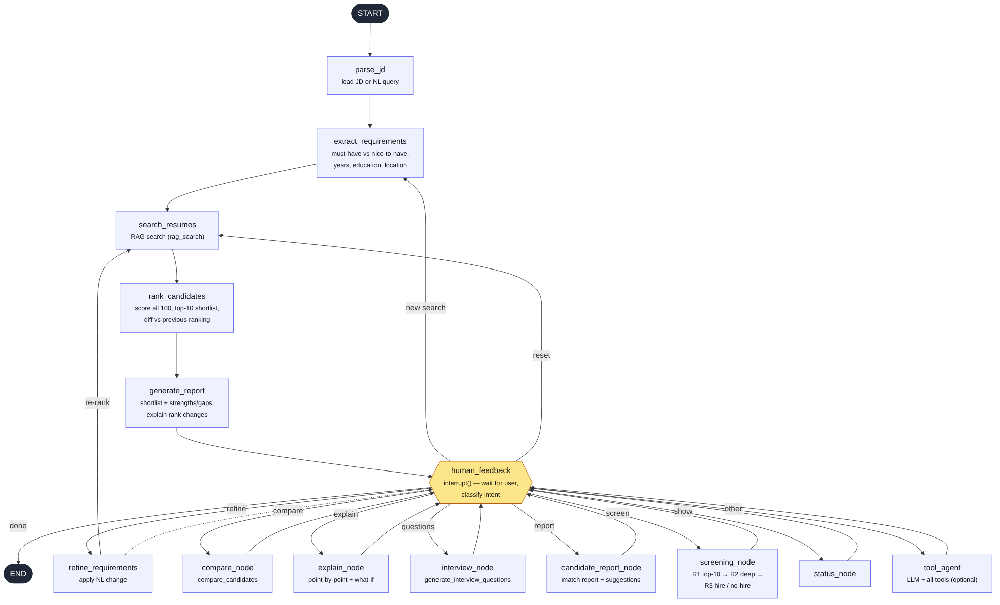
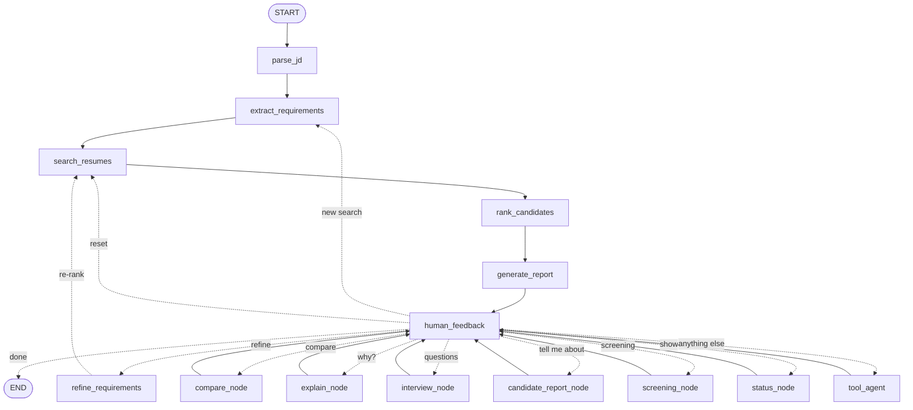

# Resume Matching Agent (Milestone 3 — LangGraph)

A conversational, explainable resume ↔ job-description matching agent built with LangGraph.

## Submission checklist

| # | Requirement | Where |
|---|---|---|
| 1 | LangGraph-based agent implementation | [`matching_agent.py`](matching_agent.py) (+ `scoring.py`, `skills.py`, `fs_tools.py`, `rag_tools.py`) |
| 2 | State machine diagram | [`docs/state_machine.png`](docs/state_machine.png) (annotated) · [`docs/state_machine_generated.png`](docs/state_machine_generated.png) (exported from the compiled graph) |
| 3 | Chat interface (CLI or Streamlit/Gradio) | **Both:** `streamlit run app.py` and `python matching_agent.py` |
| 4 | Test scenarios: 5+ conversation flows | [`docs/TEST_SCENARIOS.md`](docs/TEST_SCENARIOS.md): 6 flows with full transcripts, run as tests in `tests/test_conversation_flows.py` |
| 5 | Demo video (5–6 min) | _add your video link here_ · script: [`docs/DEMO_VIDEO_SCRIPT.md`](docs/DEMO_VIDEO_SCRIPT.md) |



## Quick start

```bash
python -m venv .venv && source .venv/bin/activate     # Windows: .venv\Scripts\activate
pip install -r requirements.txt
python generate_sample_data.py          # 100 sample resumes + a sample JD (deterministic)

streamlit run app.py                    # web chat UI → http://localhost:8501
python matching_agent.py                # CLI chat, uses data/job_descriptions/senior_fullstack.txt
python matching_agent.py --jd path/to/jd.pdf --resumes path/to/resume_folder/   # PDF/DOCX/TXT
python matching_agent.py --query "Find me candidates with React and 3+ years experience"
python matching_agent.py --demo         # scripted walkthrough of every feature (see demo_transcript.md)
python matching_agent.py --graph        # print the graph as Mermaid
python scenarios.py                     # run the 6 conversation flows → docs/TEST_SCENARIOS.md
pytest -q                               # 42 tests (unit, uploads, 6 conversation flows)
```

### Using your own resumes (PDF / Word)

- **Streamlit:** in the sidebar under **1 · Resumes**, upload one or many `.pdf`, `.docx` or `.txt` files. Expand
  *Uploaded resumes* to check that the name, years, roles and skills were read correctly. Choose **Sample resumes + my uploads**
  or **Only my uploads**, then press **Start matching**. Uploaded files are stored in `data/uploaded_resumes/`.
- **CLI:** `python matching_agent.py --resumes path/to/folder` ranks every PDF/DOCX/TXT in that folder.
- Try it with the four sample files in `data/sample_uploads/`, which use different real-world layouts (pipe-separated roles, title above
  company, `MM/YYYY` dates, a fresher with internships and projects, a Word file with "Title at Company").
- The parser understands common headings ("Work Experience", "Technical Skills", "Core Competencies", "Profile", …), dates such as
  `Jan 2020 – Present`, `04/2023 - Present`, `Mar 2017 to Feb 2024` or `2019 - 2022`, and overlapping roles. If there's no skills section,
  it detects skills across the whole resume.
- Scanned (image-only) PDFs contain no text, so they're skipped with a warning. Export them as a text PDF or DOCX instead.

**Optional LLM (e.g. Groq)** for free-form questions the rule-based router doesn't recognise. Scores never depend on it:
```bash
pip install langchain langchain-groq
export GROQ_API_KEY=...                                # Windows: $env:GROQ_API_KEY="..."
export MATCHER_LLM="groq:llama-3.3-70b-versatile"      # Windows: $env:MATCHER_LLM="groq:llama-3.3-70b-versatile"
```

## Files

| File | Purpose |
|---|---|
| `matching_agent.py` | **The agent**: state, tools, graph, intent routing, refinement, screening, CLI |
| `app.py` | Streamlit chat interface (same agent) |
| `scenarios.py` | The 6 documented conversation flows |
| `data/sample_uploads/` | Realistic PDF/DOCX resumes for trying uploads (`tools/make_sample_uploads.py` regenerates them) |
| `docs/` | State machine diagrams, test scenario transcripts, demo video script |
| `scoring.py` | Explainable matching engine: requirement parsing, scoring, deep analysis, hire decisions, explanations |
| `skills.py` | Skill taxonomy (aliases → canonical names) and resume parser (sample format + free-form PDF/DOCX layouts) |
| `fs_tools.py` | Milestone 1 file-system tools (`list_resumes`, `read_resume`, `get_resume_metadata`, `search_files`, `write_report`) |
| `rag_tools.py` | Milestone 2 RAG search (`rag_search`): chunked BM25 with skill-aware query expansion |
| `generate_sample_data.py` | 100 synthetic resumes (incl. John Smith & Jane Doe) + a sample JD |
| `tests/` | Unit/feature tests + conversation-flow tests |
| `demo_transcript.md` | Full output of `--demo` |

**Plugging in your own Milestone 1/2 code:** the agent only depends on the tool names. Replace the bodies in
`fs_tools.py`, or set `rag_tools.RETRIEVER` to any object with `.search(query, k) -> [{"candidate_id", "name", "score", "snippet"}]`
(e.g. a Chroma/FAISS wrapper). PDF and DOCX resumes work if `pypdf` / `python-docx` are installed.

---

## Part A — Agent architecture

### Graph



The required pipeline `START → Parse JD → Extract Requirements → Search Resumes → Rank Candidates → Generate Report → Human Feedback Loop → END`
is the spine. `human_feedback` uses LangGraph's `interrupt()` to pause for the user and returns a `Command(goto=...)`
to route on intent; every handler loops back to it. State persists across turns via a checkpointer (`InMemorySaver`, swap
for SQLite/Postgres for durability), keyed by `thread_id`.

### State (`AgentState`)

| Concern | Fields |
|---|---|
| Conversation history | `messages` (add_messages reducer), `last_user_message`, `intent` |
| Job understanding | `jd_text`, `requirements` (must-have skills with per-skill min years, nice-to-haves, min years, education, location, weights), `original_requirements`, `previous_requirements`, `requirement_history` (append-only versions with the change made), `change_note` |
| Candidates & reasoning | `candidate_pool` (RAG hits), `all_scores` (per-candidate breakdown: components, points, matched/missing skills, penalties), `ranking`, `shortlist` (rank + one-line reasoning), `previous_scores` / `previous_ranking`, `rank_changes` (with reasons), `screening`, `reasoning_log` (append-only audit trail of every node) |

### Tools

| Source | Tools |
|---|---|
| Milestone 1 | `list_resumes`, `read_resume`, `get_resume_metadata`, `search_files`, `write_report` |
| Milestone 2 | `rag_search` |
| New | `extract_requirements(jd)` — must-have vs nice-to-have, per-skill years, overall years, education, location · `compare_candidates(candidate_ids)` — head-to-head table + verdict · `generate_interview_questions(candidate_id)` — depth probes, gap probes, claim verification, resume deep-dive, behavioural |

All tools are LangChain `@tool`s. Graph nodes call them directly; when `MATCHER_LLM` is set (e.g. `anthropic:<model>`),
free-form questions go to `tool_agent`, which binds **all** tools to the LLM and runs a tool-calling loop.

## Part B — Interactive features

Rule-based intent routing (deterministic, no API key needed) handles:

- **Natural-language search:** "Find me candidates with React and 3+ years experience" → React becomes a must-have, 3 yrs the overall bar.
- **Compare:** "Compare the top 3 matches side by side", "John vs Jane", "compare #2 and #5".
- **Explain:** "Why did John rank higher than Jane?" → component-by-component point table, decisive factors, where the
  lower candidate is stronger, and a *what-would-flip-it* simulation. If the premise is wrong after a re-rank, the agent says so.
- **Iterative refinement:** "Make AWS a must-have", "Docker is optional", "drop GraphQL", "require 7+ years", "5+ years of Node.js",
  "prioritize experience", "degree doesn't matter", "only candidates in Chennai", or several at once.
  The agent re-searches, re-ranks, and **explains every rank change** (who entered/left the top 10 and why, e.g.
  "⬆ Ananya Martinez #6 → #1: has newly required AWS (5 yrs)"). "Reset to the original JD" restores the starting point.

## Part C — Advanced capabilities

**Multi-round screening** ("Run multi-round screening"):
1. **Round 1 — initial screen:** every resume is scored; the top 10 advance (cut-off reported).
2. **Round 2 — deep analysis:** evidence depth (years each must-have skill appears in actual roles, recency, skills *listed but never demonstrated*),
   seniority vs the bar, quantified impact, leadership signals, tenure stability / gaps, relevant certifications.
   Final = 50% round-1 + 50% evidence score; re-orderings are reported.
3. **Round 3 — decision:** Strong Hire (≥82) / Hire (≥72) / Borderline (≥60) / No Hire, with confidence based on distance from
   thresholds. A missing must-have caps at Borderline; experience far below the bar caps at Borderline/No Hire.

**Explainability:** every score is a weighted sum of named components:

| Component | Default weight | How it's computed |
|---|---|---|
| Must-have skills | 45% | per skill: 1.0 if met, years/required if short (min 0.4), 0 if missing; demonstrated use beats a bare skills-list mention |
| Experience | 20% | total years / required years (capped at 1) |
| Nice-to-have skills | 15% | fraction present |
| Resume relevance (RAG) | 12% | normalised retrieval score |
| Education | 8% | meets / one level below / below |
| Penalty | — | ×0.85 per missing must-have |

Weights are re-normalised over applicable components and can be changed in conversation. Match reports (`"Tell me about Jane Doe"`)
include the point breakdown, a must-have evidence table, strengths, gaps, **improvement suggestions for borderline candidates**
(e.g. transferable adjacent skills, a relevant certification, "fit for a less senior level"), and the hire recommendation.
All reports are saved as markdown under `reports/`.

## Design notes

- Scoring is deterministic so rankings are reproducible and auditable; an LLM is optional and never changes scores.
- The `CONTEXT` dict lets the stateless tools see the agent's current requirements; nodes sync it from state before calling tools.
- Ambiguous names ("Priya" matching two people) resolve to the highest-ranked match and the agent says so.
